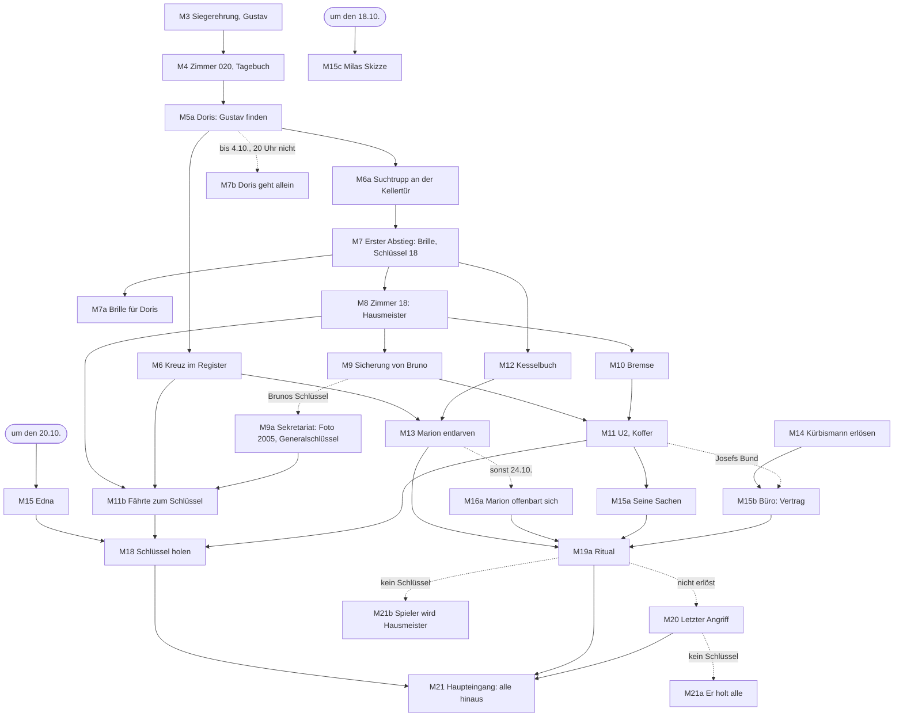

# Zimmer 13 – Hauptgeschichte und Meilensteine

Der rote Faden eines **optimalen Durchlaufs**: welche Meilensteine die Hauptgeschichte trägt, wann man sie frühestens
bzw. idealerweise erreicht und was jeder freischaltet. Entschieden wird weiter im [Spielkonzept](SPIELKONZEPT.md)
(mit Datum); hier steht der Ablauf, der die Entscheidungen verbindet. Lose Ideen ohne Platz im Ablauf gehören nach
YouTrack (Projekt ZIM, Zustand „Submitted“).

**Status je Meilenstein:** **fest** = im Spielkonzept entschieden · **Anker** = als Eckpunkt gesetzt, Ausgestaltung
offen · **vorgemerkt** = im Spielkonzept als Idee festgehalten, Einzelheiten noch nicht entschieden · **Kandidat** =
Vorschlag, noch nicht entschieden · **offen** = bewusst nicht entschieden (Ticket genannt).

Angelegt 2026-10-25.

---

## 1. Der rote Faden in Kürze

Ein friedliches Halloween-Hotel mit Türschmuck-Wettbewerb kippt bei der Siegerehrung: Gustav Peters wird geholt, und die
Puppe entpuppt sich als Urteil. Seine Freundin Doris bittet, ihn zu suchen – die Suche führt in den Keller, dort beginnt
die Ermittlung. Der Aufzug öffnet
U2 mit den Koffern früherer Gäste, der Heizraum verrät, wer das Monster war. Am Ende steht das Abkommen von 1987
und der Haupteingang: Wer an Halloween den Schlüssel hat, bringt alle hinaus, die bis dahin überlebt haben (2.7) – und
keiner von ihnen wird je darüber sprechen.

**Was der Spieler nacheinander begreift** (Schichten aus 2.3: Gerücht → Indiz → Beweis → Wahrheit):
1. Es ist real, und Deko schützt (Akt I).
2. Das Hotel macht das alle drei Jahre – die „Ernte“ (2.10) –, und es führt Buch darüber (Akt II).
3. Frühere Gäste sind nie gegangen – ihre Sachen sind noch hier (Akt III).
4. Das Monster war ein Mensch: der frühere Hausmeister Josef Ahrend (Akt IV).
5. Jeder, den man bis Halloween am Leben hält, kommt mit hinaus (Akt V–VI).

---

## 2. Ablauf nach Akten

### Akt I – Gastgeber (1.–3. Oktober) · **fest**

| Nr | Meilenstein | Wann (optimal) | Status | Zeigt auf / schaltet frei |
|----|-------------|----------------|--------|---------------------------|
| M1 | Erwachen, Willkommensbrief, Notizbuch | 1.10., 15 Uhr | fest (2.5, 3.9) | Aushangbrett in der Lobby |
| M2 | Türschmuck-Wettbewerb: Deko besorgen, Gäste kennenlernen | 1.10.–2.10. | fest (2.5) | Systeme lernen; Gustav räumt seine Tür leer |
| M3 | **Siegerehrung** – die Puppe löst sich auf, Gustav wird ungesehen geholt | 2.10., 20 Uhr | fest (2.5, 2.6) | Bruch: ab jetzt Horror |
| M4 | Zimmer 020: offene Tür, Schleifspur Richtung Keller, Gustavs Tagebuch | 2.10. abends | fest (2.6) | „Deko schützt“; erster Zug zum Keller |
| M5 | Die Regel: veränderter Aushang, Warnungszettel 1999, erstes Urteil der Puppe | 3.10. | fest (2.5, 5.5) | Puppe lesen lernen |

### Akt II – Das Hotel führt Buch (3.–7. Oktober) · bis M8 **fest**

| Nr | Meilenstein | Wann (optimal) | Status | Zeigt auf / schaltet frei |
|----|-------------|----------------|--------|---------------------------|
| M5a | **Doris bittet: Gustav finden** (K8) – bis 4.10., 20 Uhr | 2.10. nachts – 3.10. morgens | fest (2.9) | Aufgabe im Notizbuch |
| M6 | **Das Kreuz im Register** (K1) – Gustavs letzter Satz führt zur Rezeption; Mitteilung „abgereist“ am Brett | 3.10. morgens | fest (2.9) | Hotelregister: Kreuze seit 1987, „geb. Ahrend“ |
| M6a | **Der Suchtrupp** bleibt an der Kellertür stehen (K8) | 3.10. tagsüber | fest (2.9) | Lernfenster: keine Patrouille, solange er läuft |
| M7 | **Erster Abstieg** (K2): Gustavs Brille an der Leviathanmauer, Schlüssel zu Zimmer 18 | 3.–4.10. | fest (2.9, 7.4) | Zimmer 18 |
| M7a | **Die Brille für Doris:** Abschied an der Gedenktafel, Gustavs Blechdose für die Kinder, Doris als Ohrenzeugin | bis 4.10., 20 Uhr | fest (2.9) | Kinder, Gerede über den Leviathan |
| M7b | *sonst:* **Doris geht allein** – Brief in 033, Blutflecken vor der Leviathanmauer, ihr Tod ist sicher | 4.10., 20 Uhr | fest (2.9) | Schuld im Tagebuch |
| M8 | Zimmer 18 (Gast von 2005, versiegelt): Notizbuch des Hausmeisters (des Pagen von 1987, Spielkonzept 2.11) mit den Notizen des Gastes, Schaltschlüssel, UV-Aufsatz | 4.–6.10. | fest (7.4) | drei Aufgaben im Notizbuch |

### Akt III – Der Aufzug (8.–14. Oktober) · **Anker 2**

| Nr | Meilenstein | Wann (optimal) | Status | Zeigt auf / schaltet frei |
|----|-------------|----------------|--------|---------------------------|
| M9 | **Hauptsicherung:** Spind des Hausmeisters aufgebrochen (Nacht 5), Aushang der Direktion, Gerüchte → **Bruno** (K3) | ab 6.10., 2. Woche | fest (7.4, 2026-10-30) | Sicherungskasten im UG |
| M9a | **Sekretariat:** das **Foto 2005** in der offenen Schreibtischschublade (Glas gesprungen); in der zweiten Schublade mit Zahlenschloss der **Generalschlüssel** – Code 1990, die erste Ernte, aus dem Gästebuch, eine Ziffer aus Milas Nachtpartie (6.14) | 6.–10.10. (Brunos Schlüssel, K3) | fest (2.10, ZIM-6), Code: Vorschlag | Foto 2005 → Fährte zum Schlüssel (M11b); Generalschlüssel öffnet jede Zimmertür (6.19) |
| M10 | Bremse lösen im Maschinenraum (laut, neben dem schlafenden Monster) | 2. Woche | fest (7.4) | Aufzug fährt |
| M11 | **Erste Fahrt:** Die Kabine fährt ohne Knopf allein nach U2 – Lager, Fundsachen-Koffer; danach baut Hugo den Knopf für U2 ein und erzählt davon | bis 14.10. | fest (7.4), Inhalt: Kandidat (K5) | Namen der Warnungszettel als Koffer; Edna (K5) |
| M11b | **Fährte zum Schlüssel** (K6): Bleistiftnotiz in Zimmer 18 „R. hat ihn.“ – zuerst denkt man an Walter **R**uprecht in 014, eine falsche Fährte (erst seit 2023 hier, auf keinem alten Foto); das Gästebuch zeigt 2005 und 2008 „Rudolf Hain“ in 014, 2005 ohne Kreuz, 2008 mit; das Foto 2005 aus dem Sekretariat (M9a) zeigt ihn scharf neben zwei verwischten Gesichtern, 2008 an der Fotowand verwischt; Oskars Erinnerung („Einer hat das Tor aufgemacht.“) | ab M8, vor M18 | fest (2.10), Texte: Vorschlag | Rudolf Hains Koffer bei den Fundsachen in U2 (M18) |

### Akt IV – Der Hausmeister (15.–22. Oktober) · **Anker 3**

| Nr | Meilenstein | Wann (optimal) | Status | Zeigt auf / schaltet frei |
|----|-------------|----------------|--------|---------------------------|
| M12 | **Kesselbuch** in Josefs Spind (Heizraum): Josef Ahrend, Halloween 1987 (K4) | ab dem ersten Abstieg (M7) | fest (2.3, 7.4), Inhalt: Kandidat | Name Ahrend |
| M13 | **Marion entlarven** – Register „geb. Ahrend“ + Kesselbuch, Beweis und Beziehung (K4) | so früh wie möglich | fest (2.8) | **Marions Auftrag:** ihren Vater erlösen |
| M14 | Leviathanmauer bleibt nach Angriffen offen: Schlüssel zum Dachboden → Kopf des Kürbismanns, Erlösung – im Auftrag von Liesel Brück, die ihn 1987 köpfte (K7) | ab Tag 15 | fest (4.21, 2.7) | Nebenstrang mit Auftraggeberin |
| M15 | **Das Monster will die Mitwisser:** Edna wird gezielt bedroht (K5) | um den 20.10. | fest (2026-11-03, ZIM-5) | Edna ist bis hierher geschützt (Spielkonzept 6.17), hier rettbar → überlebt sie, erzählt sie; sonst Notiz in 003 |
| M15a | **Seine Sachen** aus dem Lager: Karton „Personal 1987“, Taschenuhr (K4) | nach M11 und M13 | fest (2.8), Inhalt: Vorschlag | Ritual |
| M15b | **Büro der Direktion** mit dem Schlüsselbund aus der Jeansjacke des Kürbismanns – oder mit Josefs Bund vom alten Kessel in U2 (2.8, 2026-11-03): Vertrag (K4) | nach M14 bzw. M11 | fest (2.8: Vertrag), Weg Kürbismann: Vorschlag | Ritual |
| M15c | **Milas Skizze:** Sie zeigt dem Spieler den alten Mann, den sie nachts hinten rechts in der Lobby gezeichnet hat – „Keiner außer mir hat ihn gesehen.“ Danach ist sie Mitwisserin (Spielkonzept 2.10, 6.17) | um den 18.10. | fest (2026-11-03, ZIM-8) | der alte Herr; Nachtpartie (6.14) |

### Akt V – Die letzte Woche (23.–30. Oktober)

| Nr | Meilenstein | Wann (optimal) | Status | Zeigt auf / schaltet frei |
|----|-------------|----------------|--------|---------------------------|
| M16 | Großes Schmücken täglich, Kostüme ab dem 25. | 24.–30.10. | fest (2.4, 5.9) | Laken im Flur: Gast oder Geist? |
| M16a | **Marion offenbart sich selbst**, wenn man sie bis dahin nicht entlarvt hat – nur noch eine Woche | 24.10. abends | fest (2.8), Datum: Vorschlag | Marions Auftrag, mit weniger Zeit |
| M17 | Die Leviathanmauer bleibt offen – U2 gehört dem Monster | ~25.10. | fest (7.4) | Lager und alter Heizkeller werden gefährlich |
| M18 | **Den Schlüssel holen** – aus Rudolf Hains Koffer bei den Fundsachen in U2 (K6) | offen (ZIM-22) | Fundort fest (2.10), Zeitpunkt und Weg offen | Haupteingang |

### Akt VI – Halloween (31. Oktober) · **Anker 4**

| Nr | Meilenstein | Wann (optimal) | Status | Zeigt auf / schaltet frei |
|----|-------------|----------------|--------|---------------------------|
| M19 | Fest am Abend, Gruppenfoto mit leeren Plätzen | 31.10. abends | vorgemerkt (5.9) | – |
| M19a | **Das Ritual:** mit Marion nach U2 in den alten Heizkeller, Vertrag ins Feuer von 1987, Marion ruft ihn mit seinen Sachen – er geht ins Feuer, es erlischt | Halloween-Nacht | fest (2.8), Ablauf: Vorschlag | kein letzter Angriff |
| M20 | Letztes Urteil der Puppe und letzter Angriff – nur wenn er nicht erlöst ist (Erlösung ist Kür) | 31.10. | fest (2.8) | – |
| M21 | **Ende mit Schlüssel:** Versammlung am Tor, Schlüssel ins Schloss, draußen das erste Morgengrauen; die Bedrohungen laufen zur Tür, die vor ihnen zufällt, der Vampir zerfällt im Licht; alle gehen hinaus, Gruppenfoto vor dem Hotel, das Bild wird dunkel | 31.10., Mitternachtsglocke | fest (2.7, 2026-10-26) | Ende |
| M21a | **Ende ohne Schlüssel, nicht erlöst:** alle drängen panisch ans Tor, der Leviathan holt sie in der Lobby einzeln, zuletzt den Spieler | 31.10., Mitternachtsglocke | fest (2.7, 2026-10-26) | Ende |
| M21b | **Ende ohne Schlüssel, erlöst:** das Hotel nimmt den Spieler als neuen Hausmeister – Licht aus, das Feuer von 1987 flammt wieder auf, er sieht mit den Augen des Leviathan und frisst die Gäste Stück für Stück; das Bild wird dunkel | 31.10., Mitternachtsglocke | fest (2.7, 2026-10-26) | Ende |

### Abhängigkeiten

---

## 3. Stränge im Detail

### K1 – Das Kreuz im Register (Akt II) · fest (2.9)
- Man kommt hin über Gustavs letzten Satz („Morgen früh gehe ich als Erstes zur Direktion und …“, 2.6, 2.9).
- Am Morgen nach der Siegerehrung steht im **Hotelregister** an der Rezeption ein frisches Kreuz neben „Gustav Peters“.
  Niemand hat es gemacht – Personal sieht man nie (2.5).
- Wer zurückblättert, findet **Kreuze seit 1987**, jeden dritten Oktober, meist die ganze Seite: Das Hotel macht das
  alle drei Jahre (2.10). Dazu
  „Marion Teske, geb. Ahrend“ (2.3) – ohne den Namen Ahrend zu kennen, fällt es noch nicht auf; nach dem Kesselbuch
  (M12) schon.
- **Warum stark:** kostet wenig (ein Dokument, das sich ändert), ist die Indiz-Stufe direkt nach dem Bruch und hält
  sich an 2.3 („vor dem ersten Angriff höchstens das Gästebuch“). Jeder weitere Tod bekommt sein Kreuz – das Register
  wird zur Chronik des Oktobers.

### K2 – Erster Abstieg (Akt II) · fest (2.9)
- **Das Fenster ist der Suchtrupp** (K8): Solange er an der Kellertür wartet, patrouilliert der Leviathan nicht (4.33). Die Schleifspur aus 020 zeigt in Richtung Treppenhaus Ost, Gäste reden vom Keller („Da unten soll es schlafen.“).
- Bis zum ersten Angriff hängen Vorhängeschlösser an den Kellerzugängen; das Monster hat in der Nacht der
  Siegerehrung das östliche aufgebrochen (7.4). Der Weg führt also über das Treppenhaus Ost.
- An der **Leviathanmauer** im Heizraum liegt **Gustavs Brille** – der Grund, hinunterzugehen (K8).
- Daneben liegt der **Schlüssel zu Zimmer 18** (7.4, fest), verloren 2005 vom Gast aus 018. Man sieht den Heizraum
  und die Mauer zum ersten Mal und hört dahinter etwas atmen.
- **Warum stark:** Story und Mechanik fallen zusammen – das Fenster des Suchtrupps belohnt den Mutigen, und es schließt
  sich.

### K8 – Wo ist Herr Peters? (Akt I–II) · fest (2.9)
- **Doris Lange** (zieht nach 033, gegenüber von 020), Gustavs einzige Freundin, glaubt nicht an seinen Tod und bittet
  den Spieler, ihn zu finden – auch wenn sie ihn nicht leiden kann. Frist: 4. Oktober, 20 Uhr, im Notizbuch.
- Die Direktion behauptet am Brett, er sei abgereist; sein Koffer steht noch in 020. Der Suchtrupp (Doris, Theo, Paula)
  bleibt an der Kellertür stehen.
- Unten an der Leviathanmauer liegt **seine Brille** – die einzige Spur. **Bringt man sie Doris**, nimmt sie Abschied, gibt Gustavs
  Blechdose mit dem, was er den Kindern abgenommen hat, und wird zur Ohrenzeugin. **Sonst geht sie selbst** und stirbt
  sicher; ihr Brief liegt in 033.
- **Warum stark:** gibt dem ersten Abstieg einen Grund statt nur Gerüchte, macht aus der Pflicht eine Frist mit Folgen
  und zeigt früh, dass der Spieler Tode verantworten kann – zwischen Gustav (fest) und Edna (rettbar, K5).

### K3 – Bruno hat die Sicherung (Akt III)
- **Fest (2026-10-30, Spielkonzept 7.4 „Der Einbruch“):** Jede Ernte schließt der Hausmeister – der Page von 1987
  (2.11) – die Hauptsicherung in seinen Spind im Hausmeisterraum. In der **fünften Nacht** bricht **Bruno Kaminski**
  (Kernfigur, mürrischer Händler, mutig, gierig) ihn auf. Am 6.10. bittet die Direktion per Aushang um Rückgabe – Bruno
  merkt, dass sie etwas wert ist, und behält sie als Faustpfand. Ersetzt den Gast, der sie „abgekauft“ hatte.
- Wege: Freundschaft, Handel, Mäxchen-Einsatz, Klauen (6.2). Gerüchte nennen erst die Falsche (Magda).
- Bruno ist bis dahin geschützt (6.17); hat der Spieler die Sicherung, ist Bruno Mitwisser und verwundbar.
- **Fest (2026-11-03, ZIM-6):** Im Spind hing neben der Sicherung auch der **Sekretariatsschlüssel** – Bruno behält
  beides. Über ihn öffnet sich um den 6.–10. das Sekretariat (Spielkonzept 2.10).
- **Kernfrage nebenbei:** Bruno ahnt, wofür man sie braucht, und will mit nach U2 – oder seinen Anteil am
  Lager. Teilen oder nicht (7.4)?
- **Warum stark:** gibt einer Kernfigur ihre Rolle im Geheimnis (6.0, „Zu klären“) und macht Anker 2 sozial statt nur
  mutig.

### K4 – Marions Auftrag: Josef erlösen (Akt II–VI) · fest (2.8)
- **Das Kesselbuch** in Josefs Spind (Heizraum) endet am 31.10.1987. Letzte Einträge (Entwurf der Richtung): Kohle, Druck,
  „Die Direktion will heute Nacht keine Störung“, und ein Satz an seine Tochter: „Marion soll heute nicht runterkommen.“
- **Marion entlarven:** Mit Kesselbuch und Register („geb. Ahrend“) spricht man sie an – Beweis und Beziehung (2.3).
  Hat man es bis zum **24. Oktober** nicht geschafft, klopft sie selbst an Zimmer 13. Wer früh dran ist, hat Wochen,
  wer wartet, eine Woche, in der U2 schon dem Monster gehört.
- **Ihr Auftrag** (2.8): seine Sachen aus dem Lager (Taschenuhr), der Vertrag aus dem Büro der Direktion (Schlüsselbund aus der
  Jeansjacke des Kürbismanns, Vorschlag: Liesels Auftrag führt in Marions – oder Josefs Bund vom alten Kessel, 2.8).
- **Das Ritual in der Halloween-Nacht:** im alten Heizkeller (U2) den Vertrag ins Feuer von 1987, Marion ruft ihn mit
  seinen Sachen – er geht ins Feuer, und es erlischt. Kein letzter Angriff.
- **Marion bleibt** (fest, 2.8): Sie kommt so oder so nicht hinaus – am letzten Tag bleibt sie freiwillig bei ihrem
  Vater. Wie man ihr hilft, entscheidet nur, ob er erlöst ist, nicht, ob sie lebt. Erlöst: Sie geht mit ihm ins
  Feuer und lässt die Taschenuhr zurück. Nicht erlöst: Sie bleibt in der Lobby sitzen – „Ich warte auf ihn.“
- **Scheitern:** nicht erlöst → letztes Urteil und letzter Angriff; Vertrag verbrannt, aber nicht erlöst → frei und
  ohne Warnung. Marion stirbt nicht vorher (Kernfigur, 6.17).
- **Warum stark:** Der Wendepunkt der Ermittlung wird zum großen Auftrag der zweiten Monatshälfte, verbindet drei
  Anker (Heizraum, Aufzug/Lager, Halloween) und den Kürbismann-Strang – und belohnt, wer früh ermittelt.

### K5 – Edna, die 1987 hinauskam (Akt III–V)
- **Fest (2.7):** Edna Wiegand war 1987 als Erwachsene im Hotel und gehört zu denen, die damals hinauskamen – und
  geschwiegen haben. Sie schrieb den ältesten Warnungszettel („E. K., Zimmer 017“); im Register steht sie mit
  Geburtsnamen „geb. Kessler“ (dasselbe Muster wie bei Marion). Deshalb ihre Kerzen, deshalb versteckt sie sich beim ersten
  Flackern (6.0).
- **Fest (2026-11-03, ZIM-5/7):** Sie hieß **Edna Kessler**. Im Lager (M11) steht der Koffer ihres **Verlobten Heinrich
  Brehm** von 1987 – der, der damals nicht mit hinauskam. Sie ist zurückgekommen, weil sie das Schweigen nicht mehr
  aushält. Ihre Kerze fürs Fenster (Herzensbitte) steht zum Garten hin, wo er verschwand (Spielkonzept 6.14).
- **Kandidat (2026-10-25) – sein Zimmer 042:** Der Mann floh in jener Nacht durch seine Terrassentür noch bis in den
  Garten. Sein Zimmer ist seitdem **versiegelt** (SPIELKONZEPT 6.19 (7)), sein Zimmerschlüssel mit Messinganhänger liegt
  im **Krähennest im großen Baum** gegenüber – von Krähengeneration zu Krähengeneration weitergegeben (4.25). Man holt ihn mit Geduld (füttern, er
  kommt bei hoher Gunst als Geschenk) oder mit Gewalt (ins Nest werfen). Drinnen: ein nützlicher Gegenstand und sein
  **Tagebuch**, in dem Edna vorkommt – ein Weg zu ihr, bevor sie spricht. Optional, kein Meilenstein; er heißt
  **Heinrich Brehm** (2026-11-03).
- **Fest (2026-11-03, ZIM-5) – um den 20.** will das Monster sie (2.3: „Das Monster will gerade die Mitwisser“) – die Puppe sitzt vor
  ihrer Tür. Anders als bei Gustav **kann man sie retten** (Deko, Wache, sie woanders unterbringen) – bis hierher ist sie geschützt (Spielkonzept 6.17). Überlebt sie,
  erzählt sie, wie sich der Haupteingang 1987 geöffnet hat (K6). Stirbt sie, liegt ihr Wissen als Notiz in Zimmer 003.
- **Warum stark:** gibt einer Kernfigur ihre Rolle, spiegelt Gustav (fest gegen rettbar) und zeigt das Schweigen der
  Überlebenden an einer Figur, die man kennt.

### K6 – Der Haupteingang an Halloween (Akt VI, Anker 4)
- **Fest (2.7):** Mit dem Schlüssel öffnet sich der Haupteingang, und alle, die bis zum 31. überlebt haben, kommen
  hinaus. Danach spricht keiner darüber.
- **Der Schlüssel – Fundort fest (2.10, 2026-10-30):** im **Koffer Rudolf Hains** bei den Fundsachen in U2 (7.4), mit
  Namensschild und seinem Zettel von 2008 („Ich weiß nicht mehr, woher ich ihn habe. Aber ich darf ihn nicht
  hergeben.“). Rudolf Hain trug ihn 2005 hinaus, brachte ihn 2008 ohne Erinnerung zurück und starb in jener Ernte. Die
  Fährte dorthin: M11b.
- **Offen (ZIM-22):** ab wann der Schlüssel greifbar ist und wie man ihn holt (Lagerzugang, Revier des Monsters, Hilfe
  der Gäste) – nicht entschieden.
- **Fest (2.7):** Kein Einsammeln – alle Lebenden kommen in die Lobby und gehen gemeinsam schweigend ins erste
  Morgengrauen. Ohne Schlüssel stirbt jeder, der noch drin ist, auch der Spieler; keine Zeitschleife.
- **Fest (2.7, 2026-10-26):** Die Mitternachtsglocke löst eins von drei Enden aus (M21, M21a, M21b), das Gruppenfoto
  wird danach draußen gemacht.
- **Josef erlösen** (Marions Auftrag, K4, 2.8) entscheidet, ob die letzte Nacht einen letzten Angriff hat; hinaus
  kommt man mit dem Schlüssel allein. Ohne Schlüssel entscheidet es, wer die Gäste holt: der Leviathan (M21a) oder
  der Spieler als neuer Hausmeister (M21b).

### K7 – Liesel Brück, die den Rezeptionisten köpfte (Akt IV, Auftraggeberin)
- **Fest (2.7):** Eines der beiden Kinder, die den Rezeptionisten an Halloween 1987 köpften (4.19), kam hinaus und ist
  heute als Gast zurück – um ihm seinen Kopf wiederzugeben, den sie damals auf dem Dachboden versteckt hat (4.21). Das
  andere Kind kam nicht hinaus: das Kichern beim Blitz-Dreh auf dem Dachboden.
- **Fest (2.7): Liesel Brück** (H26, Zimmer 025, ängstlich), 1987 ein Teenager, heute um die 55, Generation alt –
  „betet abends laut, schläft mit Licht“, seit 1987.
  - Sie feiert nie (Spaß ruft ihn, 4.19); wenn die Kinder das Lied vom Kürbiskopf singen (4.20), erstarrt sie.
  - Hinauf kommt sie nicht (steile Treppe, Schlüssel hinter der Leviathanmauer). Darum braucht sie den
    Spieler: Hat er ihr Vertrauen, erzählt sie, was 1987 geschah, verrät die Kammer im Südwesten und bittet ihn um das
    Ritual (4.21). Erst dann weiß man, wonach man auf dem Dachboden sucht.
  - Sie kennt den Abzählreim der Kinder von 1987 (4.21) – ein Hinweis, bevor sie spricht.
  - **Sie bleibt** (fest, 2.7): Wie Marion kommt sie so oder so nicht hinaus – am letzten Tag bleibt sie freiwillig im
    Hotel, ob der Kürbismann erlöst ist oder nicht. In der letzten Nacht steigt sie zum Dachboden hinauf, zu dem Kind,
    das 1987 nicht hinauskam – das Kichern verstummt.
- **Warum stark:** gibt dem Kürbismann-Strang eine Auftraggeberin statt eines Zufallsfunds und zeigt das Schweigen
  der Überlebenden von der anderen Seite – Schuld statt Angst.
